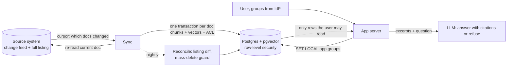

# Permission-aware RAG: department access, daily sync, regression gates

A small, working reference for an internal assistant over documents with **department-restricted access**:
permissions enforced by the database inside the search, an index that stays in sync with a source that
changes daily (and recovers from crashes without duplicates or missed updates), and an evaluation that
decides whether a change ships.

It runs on a synthetic insurer ("Maple Mutual", 300 documents, 6 departments) so every claim below is a
test you can run, not a description.

## What it proves

| Property | How it's checked | Result |
|---|---|---|
| No identity → no data | `test_no_identity_sees_nothing` | 0 rows |
| Each department sees exactly what its ACLs allow | `test_each_group_sees_exactly_what_its_acls_allow` (6 groups) | exact match with the source ACLs |
| A pooled connection can't keep the previous user's access | `test_scope_does_not_survive_the_transaction` | 0 rows |
| Incremental sync over 3 days of edits, shrinks, deletes and ACL changes = full rebuild | `test_daily_changes_match_a_full_rebuild` | identical index (ids, text, vectors, ACLs) |
| Crash mid-run, rerun → same as full rebuild, cursor never skips work | `test_crash_mid_run_then_rerun_matches_full_rebuild` (5 crash points) | identical, cursor unmoved after crash |
| Replaying every event ever emitted changes nothing | `test_replaying_the_whole_feed_changes_nothing` | no-op |
| Deletes the feed never reported are caught | `test_deletes_the_feed_missed_are_caught_by_reconcile` | removed on reconcile |
| A permission change revokes access without re-embedding | `test_permission_change_revokes_access_without_reembedding` | 0 tokens re-embedded |
| A bad document is parked, retried, and doesn't block the run | `test_bad_document_is_parked_and_retried...` | dead-lettered, then applied |
| A broken listing can't wipe the index | `test_broken_listing_cannot_wipe_the_index` | refused (mass-delete guard) |
| Filtered vector search loses results for small departments | `test_iterative_scan_fixes_missing_results...` | **legal can read 36 chunks; top-10 returned 0 without pgvector iterative scan, 10 with it** |

32 tests, offline (no API key), run in CI against Postgres 17 + pgvector 0.8.

## Architecture



**Permissions (Q1).** Every chunk carries its document's ACL. The query role (`rag_app`) has a row-level
security policy: rows are visible only if their ACL overlaps the groups set for the current transaction, so the
filter runs inside the search on both the vector and the keyword leg. Unset groups give NULL, which never
passes (fail closed). Groups are set with `set_config(..., true)`, scoped to the transaction, so a reused
pooled connection starts with nothing. The query role is not a superuser and has no `BYPASSRLS`, and
`FORCE ROW LEVEL SECURITY` covers the table owner. Prompt instructions are not access control: the model can
only leak what it's given, and it's only given what the database let this user read.

**Filtered search.** With HNSW, pgvector finds `ef_search` nearest candidates first and applies the filter
after. For a small department that silently returns too few results, which looks like a quality bug, not
a security one. `hnsw.iterative_scan = relaxed_order` (pgvector ≥ 0.8) keeps scanning until the page is full.

**Sync (Q2).**
1. The feed says *which* documents changed; the sync re-reads the source for *what* they are now, so replaying events is safe.
2. Each document is replaced in one transaction (vectors live in the same database), so a crash leaves the old version or the new one, and a document that shrank can't leave stale chunks behind. Chunk ids are deterministic (`doc_id:content_hash:index`).
3. The cursor moves only after every change it covers is applied or parked, in the same transaction that closes the run.
4. Unchanged content is never re-embedded; a permission-only change updates ACLs in place.
5. A nightly reconcile compares full listings to catch what feeds miss (here: a silent admin purge), behind a guard that refuses to delete a large share of the index.

With a vector database that has no multi-row transactions, step 2 becomes: write the new version under new ids, switch a pointer, then delete the old chunks.

**Evaluation (Q3).** A frozen set built from the source: 90 answerable questions (a user who may read the
document asks for its planted fact), 30 permission probes (a user from another department asks the same
restricted question), 15 questions about policies that don't exist. Split into dev (tune) and test (report).
Every metric is exact (value present in the answer, canary/ACL checks), so no LLM judge is needed here.
Each configuration runs 3 times (models aren't deterministic), items are compared pairwise (exact McNemar),
and a change ships only if: zero leaks in every run, no category drops more than 5 points, no significant
overall drop, p95 latency ≤ 1.25× and cost ≤ 1.25× the baseline.

## Results: dense (current) vs hybrid dense + full-text (candidate)

Test split, 88 items, `text-embedding-3-small` (256 d) + `gpt-5.4-mini`, mean over 3 runs.

| | Dense | Hybrid (RRF) |
|---|---|---|
| Right document in top 5 | 95.0% | 93.3% |
| MRR | 0.61 | 0.72 |
| Answer accuracy | 95.0% | 91.7% |
| Refusal on non-existent policies | 100% | 100% |
| Permission probes refused | 100% | 98% |
| **Leaks** | **0** | **0** |
| p50 / p95 end-to-end | 1.83 s / 2.48 s | 1.85 s / 2.45 s |
| Cost per 1,000 queries | $0.84 | $0.87 |

Hybrid ranks the right document higher, but answers don't improve (4 items only dense got right, 2 only
hybrid, p = 0.69): **all gates pass, and it still shouldn't ship as an improvement**. No regression isn't progress.

### What the evaluation caught on the way

- **A regression hidden by an improving metric.** With the first prompt, hybrid raised MRR from 0.61 to 0.72 and
  dropped refusals on non-existent policies from 96% to 78%. That category has 9 items, too few to move the
  overall paired test (p = 0.45), so the first gate passed it. The gate now checks each category on its own
  (`eval/results/v1/` keeps those runs).
- **The failures weren't what the number said.** Reading them showed the model *did* refuse in its text, but set
  `refused: false` because hybrid surfaced other years of the same policy and it mentioned them. The prompt now
  defines the contract exactly (tuned on the dev split only): refusals are 100% on test for both configurations.
- **A false leak alarm.** The leak detector flagged "7 weeks" in an answer that said "band B7". It now matches
  the number with its unit and word boundaries (`tests/test_eval_metrics.py`). A leak metric with false positives
  gets ignored.

## Run it

```bash
docker compose up -d                              # Postgres 17 + pgvector
python -m venv .venv && .venv/bin/pip install -r requirements.txt
.venv/bin/python -m pytest -q                     # 32 offline tests, ~2 min

cp .env.example .env                              # OPENAI_API_KEY, EMBEDDER=openai
.venv/bin/python cli.py reset && .venv/bin/python cli.py seed && .venv/bin/python cli.py sync
.venv/bin/python cli.py ask --groups claims "What is the claims escalation threshold in the 2024 HomeShield claims handling manual?"
.venv/bin/python cli.py mutate --days 3 && .venv/bin/python cli.py sync && .venv/bin/python cli.py reconcile
.venv/bin/python cli.py eval --mode dense --runs 3 && .venv/bin/python cli.py eval --mode hybrid --runs 3
.venv/bin/python cli.py compare dense hybrid       # exits 1 if a gate fails
```

## What this is not

- **The data is synthetic.** Real corpora have messier documents, near-duplicates and noisier questions; the
  evaluation set would come from real staff questions and grow with every production failure.
- **Groups are passed in.** In production they come from the identity provider on the server (e.g. Entra ID
  groups via Microsoft Graph), never from the request body; group changes need their own sync.
- **Revocation latency equals the sync interval.** For revocations I'd add an event-driven fast path.
- **One node, one source.** At 50,000 documents the sync would parallelise per document (each apply is
  idempotent), the source's rate limits would set the pace, and a model change would mean a blue/green re-index.
- **Small evaluation.** 88 items detect only large differences; that's why runs are repeated and categories gated.
